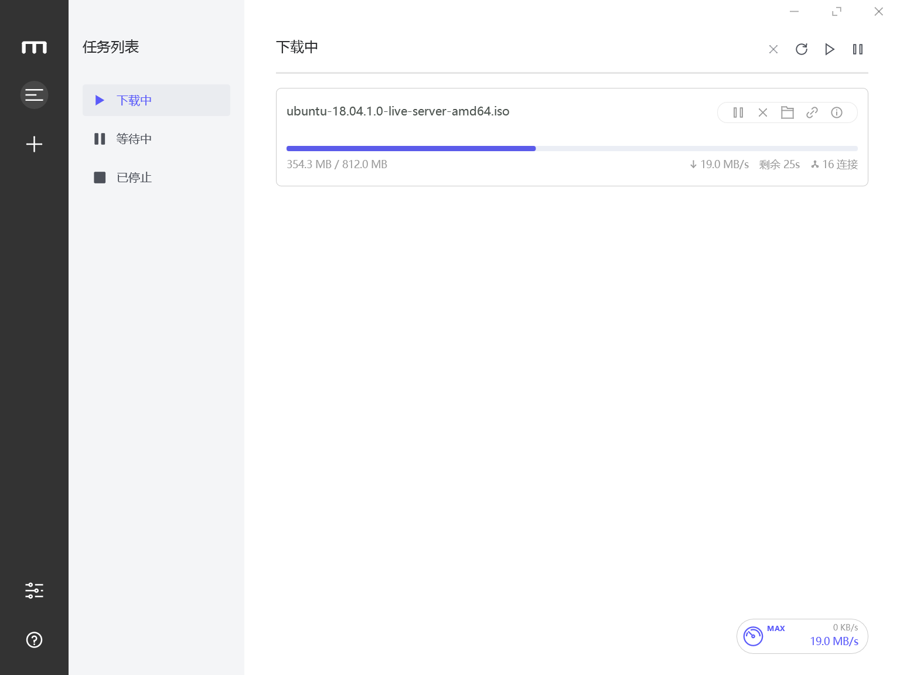

# Motrix By ImGui

使用 C++（C++23 / Win32 / DirectX 11）+ [Dear ImGui](https://github.com/ocornut/imgui) 对 [Motrix](https://github.com/agalwood/Motrix) 的非官方原生复刻，底层下载引擎切换为 [aria2-next](https://github.com/AnInsomniacy/aria2-next)（也兼容传统 `aria2c`）。

项目目的：**在保留 Motrix 1.0 视觉与交互体验的前提下，尽可能降低内存占用。**



## 说明

- 本项目仅保证对 Motrix 原有功能的复刻与支持。
- 目前仅面向 Windows。
- 本机实测内存占用（Windows 任务管理器专用工作集，仅供参考）：
  - **托盘后台待机**：主程序约 `3.4 MB`、`aria2-next.exe` 约 `1.3 MB`（合计约 `4.7 MB`）
  - **前台主界面打开**：主程序约 `16.5 MB`

## 使用与构建

直接从 GitHub Actions / Releases 下载构建好的压缩包，将 `aria2-next.exe`（或 `aria2c.exe`）放到同级 `engine/` 目录下即可运行，也可以在程序设置里指定引擎路径或在线拉取。

如果需要自己编译（Windows + VS2022/2026 + CMake >= 4.1 + Ninja）：

```powershell
pwsh -NoProfile -File .\scripts\build.ps1 -Config Release -Test
```

## 致谢与协议

- 原版 UI 与交互设计来自 [agalwood/Motrix](https://github.com/agalwood/Motrix)（MIT）。
- 引擎与相关生态参考自 [AnInsomniacy/aria2-next](https://github.com/AnInsomniacy/aria2-next)（GPL-2.0-or-later）与 [AnInsomniacy/rayburst](https://github.com/AnInsomniacy/rayburst)（MIT）。
- 本仓库代码采用 [MIT License](LICENSE)。如果连同 `aria2-next` 二进制一起打包分发，请留意其 GPL-2.0 协议要求。
